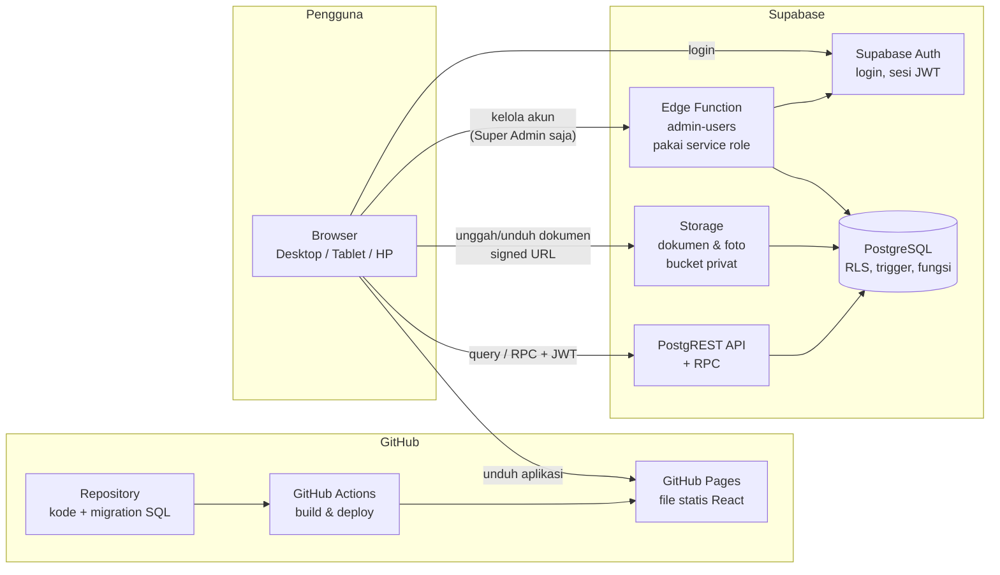
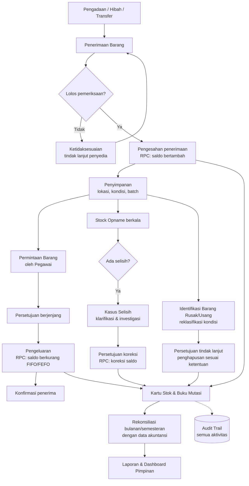
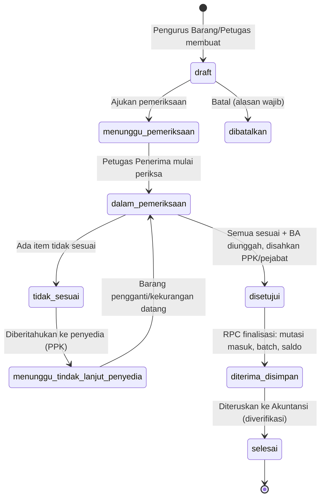
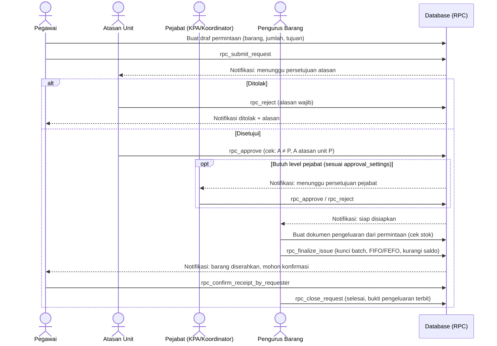
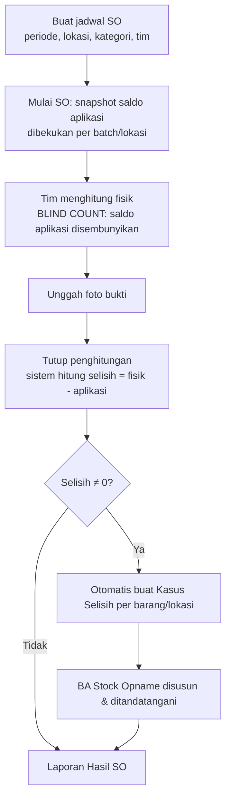
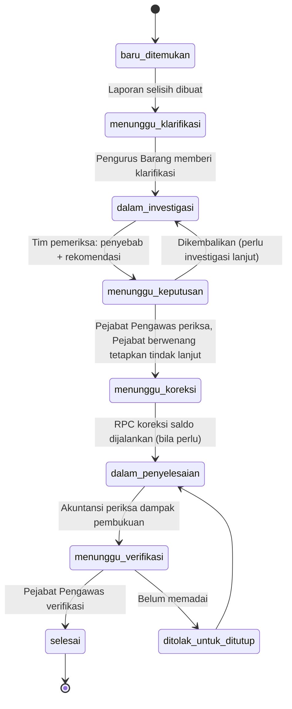
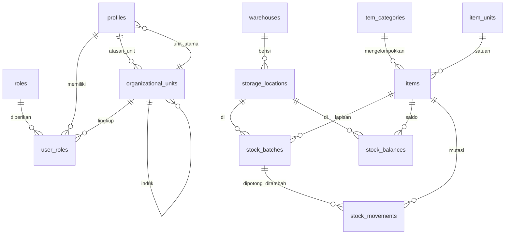
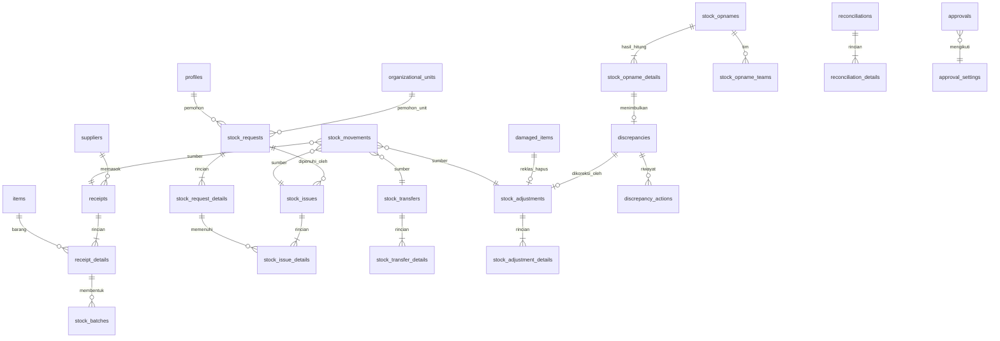

# PROJECT_SPEC.md
# SISTEM INFORMASI PENGELOLAAN PERSEDIAAN (SIPP)

| Atribut | Nilai |
|---|---|
| Versi dokumen | 1.0 |
| Tanggal | 19 November 2026 |
| Status | **DISETUJUI** — seluruh usulan default pada Bagian 11 (K1–K23) ditetapkan sebagai keputusan (lihat Bagian 12) |
| Lingkup | Satu satuan kerja pemerintah, multi-unit, multi-role |

> **Catatan untuk pembaca non-teknis:** Setiap bagian diawali ringkasan singkat ("Intinya") dalam bahasa sederhana. Rincian teknis di bawahnya terutama untuk keperluan pengembangan dan pemeriksaan.

---

## DAFTAR ISI

0. Ringkasan dan Asumsi Dasar
1. Dokumen Arsitektur Teknis
2. Diagram Workflow
3. Diagram Relasi Database (ERD)
4. Matriks Hak Akses
5. Rancangan Tabel Database
6. Rancangan Row Level Security (RLS)
7. Rancangan Struktur Folder React
8. Rancangan UI/UX
9. Daftar Risiko dan Pengendalian
10. Roadmap Pengembangan
11. Hal-hal yang Perlu Dikonfirmasi

---

## 0. RINGKASAN DAN ASUMSI DASAR

**Intinya:** SIPP adalah aplikasi web yang berjalan di browser. Tampilannya disimpan gratis di GitHub Pages, sedangkan data, login, dan dokumen disimpan di Supabase. Semua aturan penting (siapa boleh melihat apa, saldo tidak boleh minus, tidak boleh menyetujui pengajuan sendiri) dipasang **di database**, bukan hanya di tampilan, sehingga tidak bisa diakali dari browser.

### 0.1 Prinsip desain utama

1. **Database adalah penjaga terakhir.** Semua kontrol (hak akses, pemisahan fungsi, larangan stok negatif, larangan self-approval, larangan mengubah transaksi final) ditegakkan di PostgreSQL melalui RLS, constraint, trigger, dan fungsi RPC. Frontend hanya menyesuaikan tampilan.
2. **Saldo tidak pernah diubah langsung.** Saldo hanya berubah melalui *buku besar mutasi* (`stock_movements`) yang dibuat oleh fungsi RPC resmi. Tabel `stock_balances` dan `stock_batches` tertutup untuk INSERT/UPDATE/DELETE dari aplikasi.
3. **Append-only untuk jejak.** Mutasi stok, audit log, riwayat persetujuan, dan riwayat status tidak dapat diedit/dihapus. Koreksi dilakukan dengan transaksi pembalik/koreksi, bukan mengedit data lama.
4. **Pemisahan fungsi (segregation of duties).** Pembuat ≠ pemeriksa ≠ penyetuju ≠ pencatat, dan dicek di database.
5. **Atomic.** Setiap transaksi kritis berjalan dalam satu transaksi database; jika satu langkah gagal, semuanya dibatalkan.

### 0.2 Asumsi (perlu dikonfirmasi — lihat Bagian 11)

| No | Asumsi |
|---|---|
| A1 | Satu satuan kerja, satu instance Supabase, satu repository GitHub. |
| A2 | Metode penilaian persediaan: **FIFO** (sesuai PSAP 05 yang mengizinkan FIFO; kepastian kebijakan perlu dikonfirmasi bagian akuntansi). |
| A3 | Barang ber-masa kedaluwarsa dikeluarkan secara **FEFO**; nilai yang dibebankan mengikuti batch yang benar-benar dikeluarkan. |
| A4 | Login menggunakan **email + password** (Supabase Auth), akun dibuat oleh Super Admin (tidak ada pendaftaran mandiri). |
| A5 | Data akuntansi resmi (mis. dari aplikasi SAKTI) **diinput/impor manual** ke modul rekonsiliasi — tidak ada integrasi API langsung. |
| A6 | Pembuatan akun pengguna oleh Super Admin memakai **Supabase Edge Function** (bagian dari Supabase, tidak perlu server/hosting terpisah; ada kuota gratis). |
| A7 | Routing memakai **HashRouter** (URL berbentuk `.../#/penerimaan`) agar aman saat refresh di GitHub Pages. |
| A8 | Satu pengguna dapat memiliki lebih dari satu role, tetapi kombinasi role yang bertentangan dibatasi (lihat 4.3). |

---

## 1. DOKUMEN ARSITEKTUR TEKNIS

**Intinya:** Pengguna membuka aplikasi di browser → aplikasi berbicara langsung ke Supabase → Supabase memeriksa identitas dan hak akses pengguna di setiap permintaan data.

### 1.1 Diagram arsitektur



### 1.2 Komponen dan tanggung jawab

| Lapisan | Teknologi | Tanggung jawab |
|---|---|---|
| Presentasi | React 18 + TypeScript + Vite + Tailwind CSS + Lucide React | Tampilan, form, validasi awal, navigasi sesuai role |
| Routing | React Router (HashRouter) | Kompatibel GitHub Pages, aman saat refresh |
| State data | TanStack Query (React Query) | Cache, loading/error state, refetch otomatis |
| Validasi form | React Hook Form + Zod | Validasi input di sisi klien (diulang di database) |
| Grafik | Recharts | Grafik dashboard |
| Ekspor | ExcelJS (Excel), jsPDF + jspdf-autotable (PDF), CSS print | Ekspor & cetak laporan di browser |
| Tanggal | date-fns + locale `id`, `Intl` dengan zona `Asia/Jakarta` | Format tanggal Indonesia |
| Akses data | Supabase JS Client v2 (flow PKCE) | Query, RPC, Storage, Auth |
| Logika bisnis kritis | Fungsi PL/pgSQL (RPC) | Finalisasi transaksi, mutasi saldo, persetujuan |
| Keamanan data | RLS + GRANT/REVOKE + trigger | Hak akses per role & unit, imutabilitas |
| Dokumen | Supabase Storage (bucket privat) + tabel `attachments` | Surat jalan, faktur, BA, foto |
| Administrasi akun | Supabase Edge Function `admin-users` | Membuat/menonaktifkan akun (memerlukan service role, **tidak pernah** di frontend) |
| CI/CD | GitHub Actions | Lint, type-check, test, build, deploy ke Pages |
| Pengujian | Vitest + React Testing Library; pgTAP (`supabase test db`) untuk RLS & RPC | Unit, integrasi, keamanan |

### 1.3 Pola akses data

- **Membaca data:** frontend memakai `select` biasa; RLS menyaring baris sesuai role & unit.
- **Membuat/mengubah draf:** INSERT/UPDATE langsung ke tabel header/detail **hanya saat status `draft`**, dibatasi RLS + trigger.
- **Perubahan status & semua yang menyentuh saldo:** **wajib** lewat RPC (`rpc_submit_*`, `rpc_approve`, `rpc_finalize_*`). Kolom `status` tidak dapat di-UPDATE langsung (dikunci trigger).
- **Identitas pengguna:** selalu diambil dari `auth.uid()` di database, **tidak pernah** dari parameter yang dikirim frontend.

### 1.4 Mekanisme anti-saldo-ganda dan anti-stok-negatif

1. Setiap RPC finalisasi mengunci baris header transaksi (`SELECT ... FOR UPDATE`) dan memeriksa status. Jika sudah final → error "Transaksi sudah difinalisasi". Ini mencegah klik ganda/double submit.
2. Batch stok yang akan dipotong dikunci (`FOR UPDATE`) dengan urutan deterministik (FEFO/FIFO) sehingga dua transaksi bersamaan antre, bukan saling menimpa.
3. Constraint `CHECK (qty_remaining >= 0)` pada `stock_batches` dan `CHECK (quantity >= 0)` pada `stock_balances` sebagai pengaman terakhir.
4. Kolom `idempotency_key` (UUID dari frontend) pada RPC finalisasi untuk menolak pengiriman berulang.

### 1.5 Penomoran transaksi otomatis

Format: `{PREFIX}/{KODE_SATKER}/{TAHUN}/{BULAN}/{NOMOR 5 digit}`
Contoh: `PNR/SATKER01/2026/11/00012`.

| Prefix | Transaksi |
|---|---|
| PNR | Penerimaan |
| PMT | Permintaan |
| PGL | Pengeluaran |
| PND | Perpindahan lokasi |
| KOR | Koreksi saldo |
| SOP | Stock opname |
| SLS | Kasus selisih |
| BRU | Barang rusak/usang |
| RKN | Rekonsiliasi |

Nomor dibuat oleh fungsi `fn_next_document_number(prefix)` yang memakai tabel `document_sequences` dengan penguncian baris (bukan `MAX()+1`) sehingga dijamin unik meski transaksi bersamaan; ditambah `UNIQUE` constraint pada kolom nomor.

### 1.6 Penilaian persediaan (FIFO/FEFO)

- Setiap penerimaan yang disahkan membentuk **lapisan/batch** (`stock_batches`) berisi: barang, lokasi, kondisi, harga satuan, tanggal perolehan, tanggal kedaluwarsa (opsional), sisa kuantitas.
- Pengeluaran memotong batch dengan urutan:
  - barang dengan kedaluwarsa → `expiry_date ASC, received_at ASC` (FEFO);
  - barang lain → `received_at ASC, created_at ASC` (FIFO).
- Satu baris pengeluaran bisa memotong beberapa batch; setiap potongan dicatat sebagai satu `stock_movements` dengan harga satuan batch tersebut → nilai keluar akurat.
- Perpindahan lokasi memindahkan sisa batch (memecah batch bila sebagian), **harga & tanggal perolehan tetap**, sehingga urutan FIFO dan total nilai tidak berubah.

### 1.7 Kondisi barang dan saldo "layak pakai"

Saldo dipisah per kondisi: `layak_pakai`, `rusak_ringan`, `rusak_berat`, `usang`, `kedaluwarsa`, `dalam_pemeriksaan`, `menunggu_penyelesaian`.
- Hanya kondisi `layak_pakai` yang dapat diminta & dikeluarkan.
- Barang hasil penerimaan yang belum lolos pemeriksaan **tidak masuk** saldo sama sekali (tetap di dokumen penerimaan berstatus ketidaksesuaian).
- Reklasifikasi kondisi (mis. layak → rusak ringan) adalah mutasi tipe `RECLASS` yang **tidak mengubah total kuantitas & nilai**, hanya memindahkan antar-kondisi, dan memerlukan persetujuan.

---

## 2. DIAGRAM WORKFLOW

**Intinya:** Barang masuk lewat penerimaan yang diperiksa, disimpan di lokasi tertentu, keluar lewat permintaan yang disetujui berjenjang, lalu diperiksa berkala lewat stock opname. Setiap selisih menjadi kasus yang diinvestigasi sebelum saldo dikoreksi.

### 2.1 Siklus persediaan keseluruhan



### 2.2 Penerimaan barang



Aturan:
- Pemeriksa ≠ pembuat transaksi. Pengesah ≠ pemeriksa.
- Penerimaan parsial diizinkan: hanya item/jumlah yang **lolos** yang masuk saldo; sisanya tetap tercatat sebagai `qty_rejected` dengan alasan.
- Dokumen wajib sebelum `disetujui` (dapat dikonfigurasi): Berita Acara Pemeriksaan; untuk sumber *Pembelian* juga surat jalan/faktur dan kontrak/SPK.

### 2.3 Permintaan dan pengeluaran barang



Status permintaan: `draft → diajukan → menunggu_persetujuan_atasan → menunggu_persetujuan_pejabat → disetujui → menunggu_penyerahan → diserahkan → menunggu_konfirmasi_penerima → selesai`; cabang `ditolak` dan `dibatalkan`.

**Keputusan desain penting — kapan saldo berkurang:** saldo dikurangi saat **penyerahan fisik** (`rpc_finalize_issue`, status `diserahkan`), bukan saat konfirmasi pemohon, agar saldo aplikasi selalu sama dengan barang di gudang. Saat permintaan disetujui, jumlahnya **dicadangkan** (`reserved_qty`) agar tidak dijanjikan dua kali. Konfirmasi pemohon adalah bukti serah terima; bila pemohon tidak mengonfirmasi dalam N hari (dapat dikonfigurasi) akan muncul di monitoring "transaksi belum selesai".

### 2.4 Stock opname dan penanganan selisih





Catatan: Selisih yang terbukti karena *barang belum ditemukan* atau *kesalahan lokasi* dapat diselesaikan dengan perpindahan lokasi tanpa koreksi kuantitas.

### 2.5 Barang rusak/usang

`identifikasi (Pengurus Barang) → pemeriksaan (Pejabat Pengawas) → persetujuan reklasifikasi (KPA) → RPC reklasifikasi kondisi → usulan tindak lanjut (perbaikan/pemanfaatan/pemusnahan/penghapusan) → persetujuan sesuai ketentuan → (bila penghapusan disetujui dan SK diunggah) RPC penghapusan = mutasi keluar tipe WRITE_OFF → selesai`.
Barang rusak **tidak pernah** otomatis hilang dari catatan; penghapusan hanya lewat langkah terakhir dengan dokumen dasar (SK) wajib diunggah.

### 2.6 Rekonsiliasi

`buat rekonsiliasi (periode bulanan/semesteran) → sistem tarik saldo aplikasi per barang/kategori → Pengurus Barang input saldo kartu stok manual (jika ada) → Petugas Akuntansi input/impor saldo akuntansi → (opsional) tarik hasil SO terakhir → sistem hitung selisih kuantitas & nilai → keterangan per baris → reviu Pejabat Pengawas → BA Rekonsiliasi → final (dikunci)`.

---

## 3. DIAGRAM RELASI DATABASE (ERD)

**Intinya:** Gambar di bawah menunjukkan tabel-tabel utama dan bagaimana mereka saling terhubung. Tabel di tengah (`stock_movements`) adalah "buku besar" yang mencatat semua pergerakan barang.

### 3.1 ERD inti (master & stok)



### 3.2 ERD transaksi



Tabel polimorfik (`approvals`, `attachments`, `audit_logs`, `notifications`, `status_histories`) terhubung ke transaksi apa pun melalui pasangan kolom `ref_table` + `ref_id`.

---

## 4. MATRIKS HAK AKSES

**Intinya:** Tabel ini menunjukkan siapa boleh melakukan apa. Kode: **C** = membuat, **R** = melihat, **U** = mengubah (hanya draf), **A** = menyetujui/mengesahkan, **X** = memfinalisasi/mengeksekusi, **–** = tidak ada akses. Huruf kecil = terbatas (lihat catatan).

### 4.1 Kode role

| Kode | Role |
|---|---|
| SA | Super Admin |
| KPA | Kepala Satuan Kerja / KPA |
| PWS | Pejabat Pengawas / Koordinator |
| PPK | Pejabat Pembuat Komitmen |
| PPB | Petugas Penerima Barang |
| PGB | Pengurus Barang Persediaan |
| PGW | Pegawai / Unit Pemohon |
| ATS | Atasan Unit |
| AKT | Petugas Akuntansi |
| TSO | Tim Stock Opname |
| AUD | Auditor / APIP |

### 4.2 Matriks

| Modul / Aksi | SA | KPA | PWS | PPK | PPB | PGB | PGW | ATS | AKT | TSO | AUD |
|---|---|---|---|---|---|---|---|---|---|---|---|
| Dashboard | R | R (semua) | R | r (pengadaan) | r | R | r (sendiri) | r (unit) | R | r | R |
| Master barang/kategori/satuan | CRU | R | R | R | R | cRu¹ | r | r | R | R | R |
| Master unit kerja | CRU | R | R | R | – | R | r | r | R | – | R |
| Master lokasi | CRU | R | R | – | R | CRU | – | – | R | R | R |
| Master penyedia | CRU | R | R | CRU | R | R | – | – | R | – | R |
| Pengguna & role | CRU | R | – | – | – | – | – | – | – | – | R |
| Pengaturan aplikasi & approval | CRU | R | R | – | – | – | – | – | – | – | R |
| Penerimaan – buat/ubah draf | – | R | R | R | CRU | CRU | – | – | R | – | R |
| Penerimaan – pemeriksaan | – | R | R | R | X | – | – | – | R | – | R |
| Penerimaan – pengesahan | – | A | – | A² | – | – | – | – | R | – | R |
| Penerimaan – finalisasi ke saldo | – | – | – | – | – | X | – | – | R | – | R |
| Penyimpanan & saldo | – | R | R | r | r | R | r³ | r³ | R | R | R |
| Perpindahan lokasi | – | R | R | – | – | CX | – | – | R | – | R |
| Permintaan – buat/ajukan | – | – | – | – | – | – | CRU (sendiri) | CRU | – | – | – |
| Permintaan – lihat | – | R | R | – | – | R | r (sendiri/unit) | r (unit) | R | – | R |
| Permintaan – persetujuan atasan | – | – | – | – | – | – | – | A (unitnya) | – | – | – |
| Permintaan – persetujuan pejabat | – | A | A⁴ | – | – | – | – | – | – | – | – |
| Pengeluaran – siapkan & serahkan | – | R | R | – | – | CX | – | – | R | – | R |
| Pengeluaran – konfirmasi terima | – | – | – | – | – | – | X (pemohon) | – | – | – | – |
| Kartu stok | – | R | R | – | – | R | – | r (unit) | R | R | R |
| Koreksi saldo – usulan | – | – | – | – | – | C | – | – | c⁵ | – | – |
| Koreksi saldo – persetujuan | – | A | – | – | – | – | – | – | – | – | – |
| Stock opname – jadwal & tim | – | A | CRU | – | – | R | – | – | R | R | R |
| Stock opname – hitung fisik | – | – | – | – | – | – | – | – | – | CX | R |
| Stock opname – BA & finalisasi | – | A | X | – | – | R | – | – | R | X | R |
| Kasus selisih – klarifikasi | – | R | R | – | – | X | – | – | R | – | R |
| Kasus selisih – investigasi | – | R | R | – | – | – | – | – | R | X | R |
| Kasus selisih – periksa/verifikasi | – | R | X | – | – | – | – | – | R | – | R |
| Kasus selisih – keputusan | – | A | – | – | – | – | – | – | – | – | R |
| Kasus selisih – dampak pembukuan | – | R | R | – | – | – | – | – | X | – | R |
| Barang rusak – identifikasi | – | R | R | – | – | CX | – | – | R | c⁶ | R |
| Barang rusak – persetujuan | – | A | r (periksa) | – | – | – | – | – | R | – | R |
| Rekonsiliasi | – | R | R (reviu) | – | – | cU (data kartu) | – | – | CRUX | r | R |
| Laporan | R | R | R | r | r | R | r | r (unit) | R | r | R |
| Pengawasan (monitoring) | – | R | CRU | – | – | – | – | – | – | – | R |
| Audit trail | R⁷ | R | R | – | – | – | – | – | – | – | R |
| Unduh dokumen pendukung | – | R | R | r | r | R | r (sendiri) | r (unit) | R | r | R |

Catatan:
1. Pengurus Barang dapat **mengusulkan** barang baru; aktivasi oleh Super Admin (atau langsung, tergantung konfirmasi).
2. PPK mengesahkan penerimaan dari *pembelian* (terkait kontrak); KPA untuk hibah/transfer — dapat dikonfigurasi di `approval_settings`.
3. Pegawai/Atasan hanya melihat **ketersediaan** (ada/tidak & jumlah layak pakai), tanpa nilai rupiah.
4. Sesuai delegasi yang dicatat di `approval_settings`.
5. Akuntansi dapat mengusulkan koreksi **nilai** (bukan kuantitas) bila ditemukan dari rekonsiliasi.
6. Tim SO dapat menandai barang rusak yang ditemukan saat penghitungan.
7. Super Admin hanya **membaca** audit trail; tidak ada akses ubah/hapus.

### 4.3 Aturan pemisahan fungsi (ditegakkan di database)

| Kode | Aturan |
|---|---|
| SOD-1 | Penyetuju ≠ pembuat transaksi (semua jenis persetujuan). |
| SOD-2 | Pada satu penerimaan: pembuat ≠ pemeriksa ≠ pengesah. |
| SOD-3 | Pada satu permintaan: pemohon tidak dapat menyetujui di level mana pun, termasuk bila ia juga Atasan/KPA. Persetujuan dialihkan ke pejabat pengganti yang dikonfigurasi. |
| SOD-4 | Pengurus Barang yang lokasinya diopname tidak boleh menjadi penghitung blind count pada SO tersebut. |
| SOD-5 | Pengusul koreksi saldo ≠ penyetuju koreksi. |
| SOD-6 | Verifikator penutupan kasus selisih ≠ pihak yang memberi klarifikasi/investigasi. |
| SOD-7 | Super Admin tidak boleh merangkap role operasional/penyetuju (PGB, ATS, KPA, PWS, AKT) — dicegah saat penetapan role. |
| SOD-8 | Auditor tidak boleh merangkap role lain. |
| SOD-9 | Pengguna tidak dapat mengubah role-nya sendiri. |

---

## 5. RANCANGAN TABEL DATABASE

**Intinya:** Daftar tabel beserta kolom pentingnya. Semua tabel memakai ID unik (UUID), mencatat kapan dan oleh siapa dibuat/diubah.

### 5.0 Konvensi umum

- Primary key: `id uuid default gen_random_uuid()`.
- Kolom standar: `created_at timestamptz default now()`, `updated_at timestamptz`, `created_by uuid → profiles`, `updated_by uuid → profiles` (diisi otomatis oleh trigger dari `auth.uid()`, bukan dari frontend).
- Waktu disimpan `timestamptz` (UTC); ditampilkan Asia/Jakarta. Tanggal dokumen memakai `date`.
- Uang: `numeric(18,2)`; harga satuan `numeric(18,4)`; kuantitas `numeric(14,3)` (mendukung satuan pecahan seperti liter/rim).
- Status memakai **enum PostgreSQL**; perubahan status hanya via RPC dan divalidasi tabel transisi.
- Soft delete (`is_active`, `deleted_at`) **hanya** untuk master data. Transaksi tidak pernah dihapus; draf yang tidak jadi diberi status `dibatalkan`.
- Index: semua foreign key, kolom `status`, kolom tanggal transaksi, nomor dokumen, dan `pg_trgm` untuk pencarian nama/kode barang.

### 5.1 Identitas, organisasi, konfigurasi

**1. profiles** — data pengguna (terhubung 1:1 ke `auth.users`; **tanpa password**)
| Kolom | Tipe | Keterangan |
|---|---|---|
| id | uuid PK | = `auth.users.id` |
| nip | varchar(18) unique null | NIP |
| full_name | text not null | |
| email | text not null | salinan dari auth |
| position_title | text | jabatan |
| primary_unit_id | uuid → organizational_units | |
| phone | text | |
| is_active | boolean default true | nonaktif = tidak bisa login (dicek RLS) |
| last_login_at | timestamptz | |

**2. roles** — `id, code (SA/KPA/...) unique, name, description, is_system boolean`.

**3. user_roles** — penugasan role
| Kolom | Keterangan |
|---|---|
| user_id → profiles | |
| role_id → roles | |
| unit_id → organizational_units null | lingkup unit (wajib untuk ATS & PGW; null = seluruh satker) |
| valid_from, valid_until date | masa berlaku (mis. penugasan auditor, Plt.) |
| assignment_ref text | nomor SK/surat tugas |
| is_active boolean | |
| UNIQUE(user_id, role_id, unit_id) | |

**4. organizational_units** — `id, code unique, name, parent_id → self, head_user_id → profiles (atasan unit), is_active`.

**5. approval_settings** — konfigurasi persetujuan berjenjang
| Kolom | Keterangan |
|---|---|
| transaction_type | enum: receipt, request, adjustment, damaged, write_off, opname, discrepancy, reconciliation |
| level | 1, 2, 3 … |
| approver_role_code | role penyetuju level tsb |
| unit_scope | `own_unit` / `all` |
| min_value, max_value numeric null | ambang nilai rupiah (mis. permintaan > Rp5 juta perlu KPA) |
| is_required boolean | |
| delegate_user_id null | delegasi tetap |
| is_active | |

**6. app_settings** — `key text PK, value jsonb, description, updated_by, updated_at` (mis. kode satker, nama satker, batas hari konfirmasi, mode blind count, batas hari barang tidak bergerak, dokumen wajib per sumber penerimaan).

**+ document_sequences** (tambahan) — `prefix, year, month, last_number`; PK(prefix, year, month).

### 5.2 Master barang & lokasi

**7. item_categories** — `id, code unique, name, account_code (kode akun persediaan, mis. 117xxx — dikonfirmasi), is_active`. Data awal: ATK, Barang Cetakan, Bahan Komputer, Perlengkapan Kebersihan, Perlengkapan Rumah Tangga, Bahan Pemeliharaan, Barang Habis Pakai Lainnya.

**8. item_units** — `id, code unique (PCS, RIM, BOX, LTR …), name, is_active`.

**9. items** — master barang
| Kolom | Keterangan |
|---|---|
| code varchar unique | kode barang (format dikonfirmasi; dapat mengikuti kodefikasi barang persediaan) |
| name | |
| category_id → item_categories | |
| unit_id → item_units | satuan dasar |
| specification text | |
| brand text null | |
| min_stock, max_stock, safety_stock numeric | CHECK min ≤ safety ≤ max bila diisi |
| has_expiry boolean | aktifkan FEFO & wajib tanggal kedaluwarsa saat terima |
| is_active | |
| search_vector / trigram index | pencarian |

**10. warehouses** — `id, code unique, name, address, pic_user_id, is_active`.

**11. storage_locations** — `id, warehouse_id, room, rack, location_number, code unique (gabungan), is_active`. UNIQUE(warehouse_id, room, rack, location_number).

**12. suppliers** — `id, name, npwp, address, phone, email, is_active`.

### 5.3 Stok (dikunci — hanya diubah oleh RPC)

**13. stock_batches** — lapisan FIFO/FEFO
| Kolom | Keterangan |
|---|---|
| item_id, location_id | |
| condition | enum kondisi barang |
| source_receipt_detail_id null | asal batch |
| parent_batch_id null | bila hasil pecahan perpindahan/reklasifikasi |
| acquired_at date | tanggal perolehan (urutan FIFO) |
| expiry_date date null | |
| unit_cost numeric(18,4) | |
| qty_initial, qty_remaining numeric | CHECK qty_remaining ≥ 0 |
| INDEX(item_id, location_id, condition, expiry_date, acquired_at) WHERE qty_remaining > 0 | |

**14. stock_balances** — ringkasan saldo (cache yang konsisten)
| Kolom | Keterangan |
|---|---|
| item_id, location_id, condition | UNIQUE bersama |
| quantity numeric CHECK ≥ 0 | |
| reserved_qty numeric CHECK ≥ 0 AND ≤ quantity | dicadangkan permintaan disetujui |
| total_value numeric(18,2) | |
| last_movement_at | |

Dijaga oleh RPC; ada fungsi `fn_verify_balances()` yang membandingkan `stock_balances` dengan jumlah `stock_batches` dan `stock_movements` (untuk pengujian & pengawasan).

**15. stock_movements** — **buku besar mutasi (append-only)**
| Kolom | Keterangan |
|---|---|
| movement_no | nomor urut |
| movement_date date, posted_at timestamptz | |
| movement_type | enum: RECEIPT_IN, ISSUE_OUT, TRANSFER_OUT, TRANSFER_IN, ADJ_IN, ADJ_OUT, RECLASS_OUT, RECLASS_IN, WRITE_OFF, OPENING_BALANCE |
| item_id, location_id, batch_id, condition | |
| qty_in, qty_out numeric | salah satu > 0 |
| unit_cost, value_in, value_out | |
| balance_qty_after, balance_value_after | saldo berjalan per barang (untuk kartu stok cepat) |
| ref_table, ref_id, ref_no | dokumen sumber |
| description | uraian kartu stok |
| reversal_of_id null | bila mutasi pembalik |

**+ Saldo awal:** migrasi data saldo awal dilakukan sekali lewat RPC `rpc_post_opening_balance` (tipe OPENING_BALANCE) dengan BA saldo awal, kemudian dikunci.

### 5.4 Penerimaan

**16. receipts** — `receipt_no unique, receipt_date, source_type enum (pembelian, hibah, transfer, lainnya), contract_no, contract_date, order_no, supplier_id null, delivery_note_no, invoice_no, warehouse_id, status enum (draft, menunggu_pemeriksaan, dalam_pemeriksaan, tidak_sesuai, menunggu_tindak_lanjut_penyedia, disetujui, diterima_disimpan, selesai, dibatalkan), inspector_id, inspected_at, inspection_notes, approved_by, approved_at, finalized_by, finalized_at, accounting_verified_by, accounting_verified_at, cancel_reason, notes`.

**17. receipt_details** — `receipt_id, item_id, qty_ordered, qty_received, qty_accepted, qty_rejected, unit_cost, total_cost (generated), location_id (tujuan simpan), expiry_date, inspection_result enum (sesuai, tidak_sesuai_jumlah, tidak_sesuai_spesifikasi, rusak), inspection_notes`. CHECK qty_accepted + qty_rejected ≤ qty_received.

### 5.5 Permintaan, persetujuan, pengeluaran

**18. stock_requests** — `request_no unique, request_date, requester_id, unit_id, purpose text not null, status enum (lihat 2.3), current_approval_level, submitted_at, rejected_reason, cancel_reason, completed_at`.

**19. stock_request_details** — `request_id, item_id, qty_requested, qty_approved, qty_issued, notes`. CHECK qty_approved ≤ qty_requested.

**20. approvals** — riwayat & antrean persetujuan (append-only)
| Kolom | Keterangan |
|---|---|
| ref_table, ref_id | transaksi yang disetujui |
| level, required_role_code | dari approval_settings |
| approver_id | |
| decision enum (pending, approved, rejected, returned) | |
| decision_at, notes | alasan wajib bila rejected/returned |
| CHECK/trigger: approver_id ≠ pembuat transaksi | |

**21. stock_issues** — `issue_no unique, issue_date, request_id, unit_id, recipient_id (identitas penerima, wajib), recipient_name_snapshot, handed_over_by, handed_over_at, recipient_confirmed_at, status enum, total_value, cancel_reason`.

**22. stock_issue_details** — `issue_id, request_detail_id, item_id, location_id, qty_issued, total_value` (rincian batch & harga ada di `stock_movements`).

**+ stock_transfers / stock_transfer_details** (tambahan) — perpindahan lokasi: `transfer_no, transfer_date, reason not null, status`; rincian `item_id, from_location_id, to_location_id, qty`. CHECK from ≠ to.

**+ stock_adjustments / stock_adjustment_details** (tambahan) — koreksi saldo/nilai & reklasifikasi kondisi: `adjustment_no, adjustment_type enum (koreksi_kuantitas, koreksi_nilai, reklasifikasi_kondisi, penghapusan), source_ref_table/id (kasus selisih/barang rusak), reason, status, approved_by`; rincian `item_id, location_id, condition_from, condition_to, qty_delta, value_delta`.

### 5.6 Pengendalian

**23. stock_opnames** — `opname_no unique, period_label, scheduled_date, start_at, end_at, scope_warehouse_ids uuid[], scope_location_ids uuid[], scope_category_ids uuid[], is_blind_count boolean default true, status enum (direncanakan, berjalan, penghitungan_ditutup, ba_disusun, final, dibatalkan), ba_no, approved_by`.

**+ stock_opname_teams** (tambahan) — `opname_id, user_id, team_role enum (ketua, penghitung, saksi, pengurus_barang)`.

**24. stock_opname_details** — `opname_id, item_id, location_id, condition, system_qty (snapshot, disembunyikan dari penghitung saat blind), system_value, physical_qty, counted_by, counted_at, recount_qty, difference_qty (generated = physical − system), difference_value, notes`. UNIQUE(opname_id, item_id, location_id, condition).

**25. discrepancies** — kasus selisih
| Kolom | Keterangan |
|---|---|
| case_no unique, case_date | |
| opname_detail_id null | asal (SO / rekonsiliasi / temuan lain) |
| source_type | stock_opname, rekonsiliasi, temuan |
| item_id, location_id | |
| admin_qty, physical_qty, difference_qty, difference_value | |
| clarification text | dari Pengurus Barang |
| cause_category enum | kesalahan_pencatatan_penerimaan, kesalahan_pencatatan_pengeluaran, kesalahan_satuan, kesalahan_lokasi, belum_ditemukan, kehilangan, kerusakan, lainnya |
| cause_detail, investigation_result, recommendation | |
| decision text, decided_by, decided_at | pejabat berwenang |
| corrective_action text, adjustment_id null | |
| accounting_impact_notes, accounting_checked_by | |
| verified_by, verified_at | |
| status enum (lihat 2.4) | |

**26. discrepancy_actions** — riwayat status & komentar kasus (append-only): `discrepancy_id, action_type, from_status, to_status, comment, actor_id, created_at`.

**27. damaged_items** — `report_no, identified_at, item_id, location_id, batch_id null, damage_type enum (rusak_ringan, rusak_berat, usang, kedaluwarsa), qty, estimated_value, cause, recommendation enum (perbaikan, pemanfaatan, pemusnahan, penghapusan, lainnya), status enum (dalam_pemeriksaan, menunggu_persetujuan, disetujui, menunggu_penyelesaian, selesai, ditolak), approved_by, follow_up_notes, decree_no (SK penghapusan), reclass_adjustment_id, writeoff_adjustment_id`.

**28. reconciliations** — `recon_no, period_type enum (bulanan, semesteran), period_start, period_end, status enum (draft, input_data, reviu, final), prepared_by, reviewed_by, finalized_at`.

**29. reconciliation_details** — `reconciliation_id, item_id null, category_id null, app_qty, app_value, stockcard_qty, stockcard_value, accounting_qty, accounting_value, opname_qty, opname_value, diff_qty_*, diff_value_* (generated), explanation, resolution_status`.

### 5.7 Pendukung

**30. attachments** — `ref_table, ref_id, doc_type enum (surat_jalan, faktur, kontrak, ba_pemeriksaan, ba_penerimaan, ba_stock_opname, foto, sk, lainnya), storage_path, file_name, mime_type, size_bytes, sha256 (hash integritas), uploaded_by`. File di Storage bucket privat `documents/{ref_table}/{ref_id}/{uuid}`. Tidak dapat dihapus setelah transaksi final.

**31. audit_logs** — append-only
| Kolom | Keterangan |
|---|---|
| id bigint identity | urut |
| occurred_at timestamptz | |
| user_id, user_name_snapshot, roles_snapshot text[] | |
| action | LOGIN, LOGOUT, INSERT, UPDATE, DELETE, APPROVE, REJECT, CANCEL, CORRECTION, ROLE_CHANGE, CONFIG_CHANGE, DOC_DOWNLOAD, … |
| table_name, record_id | |
| old_data jsonb, new_data jsonb | |
| ip_address, user_agent | bila tersedia (dari header request PostgREST) |
| prev_hash, row_hash | **rantai hash** untuk mendeteksi manipulasi |

**32. notifications** — `user_id, title, message, ref_table, ref_id, is_read, created_at`.

**+ status_histories** (tambahan, generik) — `ref_table, ref_id, from_status, to_status, actor_id, comment, created_at` untuk seluruh transaksi selain kasus selisih.

### 5.8 Fungsi RPC utama (rencana)

| Fungsi | Fungsi bisnis | Validasi kunci |
|---|---|---|
| `rpc_submit_receipt_for_inspection` | Ajukan pemeriksaan | role PGB/PPB, status draft, ada rincian |
| `rpc_record_receipt_inspection` | Catat hasil periksa | role PPB, pemeriksa ≠ pembuat |
| `rpc_approve_receipt` | Pengesahan | role sesuai approval_settings, ≠ pembuat/pemeriksa, dokumen wajib ada |
| `rpc_finalize_receipt` | Masuk saldo | status disetujui, kunci baris, buat batch + mutasi + saldo, idempoten |
| `rpc_submit_request` / `rpc_cancel_request` | Ajukan/batal | pemilik, status sesuai |
| `rpc_decide_approval` | Setujui/tolak/kembalikan | self-approval, lingkup unit, level berurutan, alasan wajib saat tolak |
| `rpc_finalize_issue` | Pengeluaran | kunci batch FIFO/FEFO, stok layak cukup, penerima wajib |
| `rpc_confirm_issue_receipt` | Konfirmasi pemohon | hanya pemohon/penerima |
| `rpc_transfer_location` | Pindah lokasi | total saldo & nilai tetap (diverifikasi di akhir fungsi) |
| `rpc_submit_adjustment` / `rpc_post_adjustment` | Koreksi saldo | sumber wajib (kasus/BA), disetujui, pengusul ≠ penyetuju |
| `rpc_start_opname` | Snapshot saldo | kunci lokasi dalam lingkup dari transaksi lain selama SO (opsional, dikonfirmasi) |
| `rpc_submit_count` | Input hitung fisik | anggota tim penghitung, SO berjalan |
| `rpc_close_opname_count` / `rpc_finalize_opname` | Hitung selisih, buat kasus | otomatis buat `discrepancies` |
| `rpc_discrepancy_transition` | Alur kasus | role per langkah, SOD-6 |
| `rpc_reclassify_condition` / `rpc_write_off` | Barang rusak | persetujuan + SK |
| `rpc_finalize_reconciliation` | Kunci rekonsiliasi | reviu PWS |
| `rpc_log_auth_event` | Catat login/logout | `auth.uid()` |

Semua fungsi: `SECURITY DEFINER` hanya bila perlu menulis ke tabel terkunci, dengan `SET search_path = ''`, nama tabel ditulis lengkap (`public.items`), validasi role di awal fungsi, dan `REVOKE EXECUTE FROM public, anon` lalu `GRANT EXECUTE TO authenticated`.

---

## 6. RANCANGAN ROW LEVEL SECURITY (RLS)

**Intinya:** RLS adalah "satpam" di setiap tabel. Setiap kali ada yang meminta data, database memeriksa siapa yang meminta dan hanya memberikan baris yang boleh ia lihat — walaupun seseorang mencoba mengakali dari browser.

### 6.1 Fungsi pembantu (helper)

Disimpan di schema `private` (tidak terekspos API), `STABLE`, `SECURITY DEFINER`, `search_path = ''`:

| Fungsi | Kembalian |
|---|---|
| `private.current_user_is_active()` | true bila profil aktif |
| `private.has_role(role_code text)` | true bila pengguna memiliki role aktif dan berlaku hari ini |
| `private.has_any_role(codes text[])` | |
| `private.user_unit_ids(role_code text)` | daftar unit yang menjadi lingkup role tsb |
| `private.is_unit_head_of(unit_id uuid)` | true bila atasan unit tsb (termasuk subunit) |
| `private.is_auditor_in_scope(table, date)` | cek penugasan auditor (masa berlaku) |

Pemanggilan dalam policy ditulis `(select private.has_role('PGB'))` agar dievaluasi sekali per query (performa).

### 6.2 Kebijakan dasar semua tabel

1. `ALTER TABLE ... ENABLE ROW LEVEL SECURITY` di **semua** tabel schema `public` (tanpa `FORCE`, karena fungsi `SECURITY DEFINER` milik pemilik tabel memang perlu melewati RLS secara terkendali; pengguna aplikasi `anon`/`authenticated` tetap selalu terkena RLS).
2. `REVOKE ALL ON ALL TABLES IN SCHEMA public FROM anon;` — pengguna yang belum login tidak dapat mengakses apa pun.
3. Semua policy mensyaratkan `private.current_user_is_active()`.
4. Tidak ada policy `DELETE` pada tabel transaksi; master data memakai soft delete.

### 6.3 Ringkasan policy per kelompok tabel

| Tabel | SELECT | INSERT | UPDATE | DELETE |
|---|---|---|---|---|
| profiles | diri sendiri; SA, KPA, PWS, AUD semua; ATS anggota unitnya; nama/NIP rekan untuk tampilan (melalui view terbatas) | — (via Edge Function) | diri sendiri: kolom terbatas (telepon); SA: semua kecuali role diri sendiri | — |
| roles | semua yang login | — | — | — |
| user_roles | diri sendiri; SA; AUD | SA (trigger SOD-7/8/9) | SA | — (nonaktifkan) |
| organizational_units, item_*, items, warehouses, storage_locations | semua yang login (master) | SA; PGB untuk lokasi; PPK untuk suppliers | sama dengan INSERT | — |
| approval_settings, app_settings | semua yang login (baca) | SA | SA | — |
| receipts / details | PGB, PPB, PPK, KPA, PWS, AKT, AUD | PGB, PPB (status draft, created_by = auth.uid()) | pembuat, **hanya bila status draft** | — |
| stock_balances, stock_batches, stock_movements | PGB, KPA, PWS, AKT, TSO, AUD (penuh); PGW/ATS via **view** `v_item_availability` tanpa nilai | **tidak ada** (hanya RPC) | **tidak ada** | **tidak ada** |
| stock_requests / details | pemohon sendiri; ATS unitnya; PGB; KPA; PWS; AKT; AUD | PGW/ATS: `requester_id = auth.uid()` dan `unit_id ∈ unitnya` | pemohon, hanya status draft | — |
| approvals | pihak terkait transaksi + KPA, PWS, AUD | **tidak ada** (RPC) | **tidak ada** | — |
| stock_issues / details | pemohon/penerima; ATS unitnya; PGB; KPA; PWS; AKT; AUD | — (RPC) | — (RPC) | — |
| stock_transfers, stock_adjustments | PGB, KPA, PWS, AKT, AUD | PGB (draft) | pembuat (draft) | — |
| stock_opnames / teams | KPA, PWS, PGB, AKT, AUD; TSO yang menjadi anggota | PWS | PWS (status direncanakan) | — |
| stock_opname_details | seperti di atas, **tetapi kolom `system_qty/system_value` disembunyikan** dari penghitung selama blind count (akses lewat view `v_opname_count_sheet`) | — (RPC) | — (RPC) | — |
| discrepancies / actions | KPA, PWS, PGB, TSO (anggota), AKT, AUD | — (RPC) | — (RPC) | — |
| damaged_items | PGB, KPA, PWS, AKT, TSO, AUD | PGB, TSO | pembuat (status awal) | — |
| reconciliations / details | AKT, PGB, KPA, PWS, AUD | AKT | AKT (non-final); PGB kolom kartu stok | — |
| attachments | mengikuti hak SELECT transaksi induknya (fungsi `private.can_read_ref(ref_table, ref_id)`) | pengunggah dengan hak ubah transaksi induk yang belum final | — | — |
| audit_logs | SA, KPA, PWS, AUD | **tidak ada** (hanya trigger) | **tidak ada** | **tidak ada** |
| notifications | milik sendiri | — (trigger/RPC) | milik sendiri: kolom `is_read` | — |

### 6.4 Imutabilitas di luar RLS (lapis kedua)

- Trigger `trg_block_final_update` pada setiap tabel transaksi: menolak UPDATE/DELETE bila status termasuk final (`selesai`, `final`, `diterima_disimpan`, dsb.).
- Trigger `trg_block_status_change`: kolom `status` hanya boleh berubah bila variabel sesi `app.via_rpc = 'on'` (diset di dalam RPC).
- `stock_movements`, `approvals`, `audit_logs`, `discrepancy_actions`, `status_histories`: `REVOKE UPDATE, DELETE, TRUNCATE` dari `authenticated`, `anon`, dan pemilik non-superuser; plus trigger penolak.
- Audit log memiliki rantai hash: setiap baris menyimpan `sha256(prev_hash || isi baris)`. Fungsi `fn_verify_audit_chain()` mendeteksi bila ada baris yang diubah langsung oleh admin database.

> **Batas yang perlu dipahami:** Pemilik proyek Supabase (akses dashboard/SQL editor) secara teknis tetap memiliki akses superuser. Pengendalian untuk ini bersifat administratif: batasi siapa yang memegang akun Supabase, aktifkan 2FA, dan gunakan rantai hash untuk mendeteksi perubahan. Persyaratan "tidak dapat diubah melalui aplikasi" terpenuhi sepenuhnya.

### 6.5 Storage

- Bucket `documents` dan `photos`: **privat**, batas ukuran (mis. 10 MB), tipe file dibatasi (PDF, JPG, PNG).
- Policy `storage.objects`: unggah hanya ke path transaksi yang boleh diubah pengguna; unduh via **signed URL** berumur pendek setelah `private.can_read_ref` lolos; tidak ada delete.
- Pengunduhan dokumen penting dicatat via RPC `rpc_get_document_url` yang menulis audit log lalu membuat signed URL.

### 6.6 Rencana pengujian RLS

Dengan pgTAP (`supabase test db`), untuk **setiap role** dibuat pengguna uji, lalu diuji minimal:
- dapat melihat/tidak melihat baris yang seharusnya (termasuk lintas unit);
- tidak dapat INSERT/UPDATE `stock_balances`, `stock_movements`, `audit_logs` langsung;
- tidak dapat menyetujui transaksi sendiri (SOD-1..6);
- tidak dapat mengubah transaksi final;
- pengguna nonaktif tidak dapat membaca apa pun;
- `anon` tidak dapat membaca apa pun;
- auditor tidak dapat mengubah apa pun;
- penghitung blind count tidak dapat membaca `system_qty`;
- dua pengeluaran bersamaan atas stok terakhir → satu berhasil, satu gagal, saldo tidak negatif.

---

## 7. RANCANGAN STRUKTUR FOLDER REACT

**Intinya:** Kode dikelompokkan per modul (penerimaan, permintaan, dll.) sehingga mudah dikembangkan bertahap.

```
sipp/
├── .github/workflows/
│   ├── ci.yml                    # lint, type-check, test pada setiap push/PR
│   └── deploy.yml                # build & deploy ke GitHub Pages (manual/tag)
├── docs/
│   ├── PROJECT_SPEC.md           # dokumen ini
│   ├── DATABASE.md               # kamus data & fungsi
│   ├── DEPLOYMENT.md             # panduan GitHub Pages + Supabase
│   ├── USER_GUIDE.md             # panduan pengguna per role
│   └── TESTING.md
├── supabase/
│   ├── config.toml
│   ├── migrations/               # file SQL berurutan, tidak pernah diedit setelah diterapkan
│   │   ├── 0001_extensions_and_schemas.sql
│   │   ├── 0002_enums.sql
│   │   ├── 0003_identity_org.sql
│   │   ├── 0004_master_data.sql
│   │   ├── 0005_stock_ledger.sql
│   │   ├── 0006_audit_trail.sql
│   │   ├── 0007_rls_helpers_and_policies.sql
│   │   └── ...
│   ├── functions/admin-users/    # Edge Function kelola akun (service role ada di sini, bukan di frontend)
│   ├── seed.sql                  # data contoh KHUSUS development
│   └── tests/                    # pgTAP: rls_*.test.sql, rpc_*.test.sql
├── public/
│   └── favicon.svg
├── src/
│   ├── main.tsx
│   ├── App.tsx
│   ├── app/
│   │   ├── router.tsx            # HashRouter + rute terlindungi
│   │   ├── providers.tsx         # QueryClient, Auth, Toast
│   │   └── navigation.ts         # definisi menu + role yang boleh melihat
│   ├── lib/
│   │   ├── supabase.ts           # klien Supabase (anon key dari env)
│   │   ├── format.ts             # tanggal Indonesia, Rupiah, angka
│   │   ├── export/               # excel.ts, pdf.ts, print.ts
│   │   └── errors.ts             # terjemahan error DB → pesan Indonesia
│   ├── types/
│   │   ├── database.types.ts     # dihasilkan otomatis dari skema Supabase
│   │   └── domain.ts
│   ├── components/
│   │   ├── layout/               # AppShell, Sidebar, Header, Breadcrumb
│   │   ├── ui/                   # Button, Input, Select, Modal, ConfirmDialog, Badge, Card, Toast, Tabs
│   │   ├── data-table/           # DataTable (cari, filter, sort, pagination)
│   │   ├── status/               # StatusBadge, StatusTimeline
│   │   ├── attachments/          # FileUploader, AttachmentList
│   │   ├── approval/             # ApprovalPanel, ApprovalHistory
│   │   └── feedback/             # LoadingState, EmptyState, ErrorState
│   ├── features/
│   │   ├── auth/                 # LoginPage, useAuth, RequireRole
│   │   ├── dashboard/
│   │   ├── master-data/          # items, categories, units, org-units, warehouses, locations, suppliers
│   │   ├── receipts/
│   │   ├── storage/              # saldo, monitoring, perpindahan lokasi
│   │   ├── requests/
│   │   ├── issues/
│   │   ├── stock-card/
│   │   ├── stock-opname/
│   │   ├── discrepancies/
│   │   ├── damaged-items/
│   │   ├── reconciliation/
│   │   ├── reports/
│   │   ├── supervision/
│   │   ├── users/
│   │   ├── audit/
│   │   └── settings/
│   │       # setiap fitur berisi:
│   │       #   api.ts        → akses data (query/RPC) — satu-satunya tempat memanggil Supabase
│   │       #   hooks.ts      → React Query hooks
│   │       #   schema.ts     → validasi Zod
│   │       #   pages/        → halaman
│   │       #   components/   → komponen khusus fitur
│   │       #   __tests__/
│   └── styles/index.css
├── tests/                         # integration test lintas fitur
├── .env.example                   # contoh variabel (TANPA nilai rahasia)
├── .gitignore                     # mengecualikan .env, .env.local, supabase/.temp
├── index.html
├── package.json
├── tailwind.config.ts
├── tsconfig.json
└── vite.config.ts                 # base: '/<nama-repo>/'
```

Variabel lingkungan frontend (publik, aman di-bundle):
```
VITE_SUPABASE_URL=
VITE_SUPABASE_ANON_KEY=        # atau publishable key
VITE_APP_BASE_PATH=/sipp/
```
`SUPABASE_SERVICE_ROLE_KEY` **hanya** disimpan sebagai secret Edge Function di dashboard Supabase. CI menambahkan langkah pemeriksaan agar build gagal bila bundle berisi string `service_role`.

---

## 8. RANCANGAN UI/UX

**Intinya:** Tampilan bersih bernuansa hijau, menu di kiri, dan setiap transaksi selalu memperlihatkan status dan langkah berikutnya dengan jelas.

### 8.1 Gaya visual

| Unsur | Ketentuan |
|---|---|
| Warna utama | Hijau `#15803D` (green-700); hover `#166534`; aksen muda `#DCFCE7` |
| Latar | `#F8FAFC` (abu sangat muda), kartu putih |
| Teks | `#0F172A` utama, `#475569` sekunder |
| Huruf | Inter / sistem; ukuran dasar 14–16 px; angka tabular untuk kolom angka |
| Ikon | Lucide React |
| Kontras | Minimal WCAG AA |

Warna badge status:

| Kelompok | Warna | Contoh status |
|---|---|---|
| Draf/netral | Abu | Draft, Direncanakan |
| Menunggu | Kuning/amber | Menunggu persetujuan, Menunggu pemeriksaan, Menunggu konfirmasi |
| Proses | Biru | Dalam pemeriksaan, Dalam investigasi, Diserahkan |
| Berhasil | Hijau | Disetujui, Selesai, Final |
| Masalah | Merah | Ditolak, Tidak sesuai, Rusak berat |
| Perhatian | Oranye | Stok minimum, Kedaluwarsa, Menunggu tindak lanjut penyedia |

### 8.2 Tata letak

```
┌──────────────────────────────────────────────────────────────────┐
│ [≡] SIPP – Sistem Informasi Pengelolaan Persediaan  🔔3  [Nama ▾]│  ← Header
├────────────┬─────────────────────────────────────────────────────┤
│ Dashboard  │  Beranda › Penerimaan › PNR/SATKER01/2026/11/00012   │
│ Master Data│  ┌───────────────────────────────────────────────┐  │
│ Penerimaan │  │ [Badge: Dalam pemeriksaan]   Langkah berikutnya│  │
│ Penyimpanan│  │ Stepper: Draf ● Periksa ◐ Sahkan ○ Simpan ○    │  │
│ Permintaan │  └───────────────────────────────────────────────┘  │
│ Pengeluaran│  [Tab: Rincian | Dokumen | Persetujuan | Riwayat]    │
│ Kartu Stok │  Tabel rincian barang ...                            │
│ Stock Opnm │                                                      │
│ Selisih    │                     [Batal]  [Simpan Hasil Periksa]  │
│ Rusak/Usang│                                                      │
│ Rekonsilia │                                                      │
│ Laporan    │                                                      │
│ Pengawasan │                                                      │
│ Pengguna   │                                                      │
│ Pengaturan │                                                      │
└────────────┴─────────────────────────────────────────────────────┘
```
- Desktop: sidebar tetap; tablet: sidebar dapat dilipat; HP: sidebar jadi laci (drawer), tabel berubah jadi daftar kartu.
- Menu hanya muncul sesuai role (dan halaman tetap dilindungi RLS bila URL diketik manual).

### 8.3 Pola halaman standar

1. **Halaman daftar:** judul + tombol "Buat Baru" (bila berhak) → filter (periode, status, unit, kategori) → kotak cari → tabel dengan sorting & pagination → ekspor Excel/PDF/Cetak.
2. **Halaman detail transaksi:** kartu status + stepper alur; tab Rincian / Dokumen / Persetujuan / Riwayat; tombol aksi hanya yang relevan untuk role & status saat ini.
3. **Form transaksi:** maksimal 2 kolom, isian wajib bertanda *, pemilih barang dengan pencarian kode/nama & info stok tersedia, validasi langsung, ringkasan sebelum kirim.
4. **Konfirmasi tindakan penting:** dialog berisi ringkasan dampak (mis. "Saldo Kertas HVS A4 akan berkurang 10 rim, nilai Rp550.000"); untuk penolakan/pembatalan wajib isi alasan.
5. **Notifikasi:** toast berhasil/gagal; pesan error database diterjemahkan ke bahasa Indonesia yang jelas (mis. "Stok tidak mencukupi. Tersedia 4 rim.").
6. **Loading/empty/error state** di setiap tabel dan kartu.

### 8.4 Dashboard per role

| Role | Fokus kartu & grafik |
|---|---|
| KPA, PWS | Semua indikator: nilai persediaan, permintaan menunggu, stok minimum/berlebih, barang rusak, selisih terbuka, transaksi belum selesai; grafik masuk-keluar, nilai, penggunaan per unit; aktivitas terbaru |
| PGB | Antrean kerja: penerimaan siap disimpan, permintaan siap disiapkan, stok minimum, kedaluwarsa ≤ 90 hari, barang tidak bergerak |
| ATS | Permintaan unit menunggu persetujuan saya; penggunaan unit per bulan |
| PGW | Status permintaan saya; tombol "Ajukan Permintaan" |
| AKT | Nilai persediaan, mutasi bulan berjalan, rekonsiliasi berjalan, kasus selisih yang perlu dicek dampaknya |
| PPK, PPB | Penerimaan per kontrak, penerimaan menunggu pemeriksaan, ketidaksesuaian |
| TSO | Jadwal SO, lembar hitung yang belum selesai |
| AUD | Ringkasan seluruhnya (baca saja) + pintasan audit trail |
| SA | Pengguna aktif, role, konfigurasi, kesehatan data (hasil `fn_verify_balances`) |

### 8.5 Laporan & cetak

- Kop laporan: nama satker, judul, periode, tanggal cetak, nama pencetak.
- Blok tanda tangan sesuai jenis laporan (mis. Pengurus Barang & KPA).
- Angka rupiah `Rp1.234.567,00`; tanggal `19 November 2026`; waktu `20.42 WIB`.

---

## 9. DAFTAR RISIKO DAN PENGENDALIAN

**Intinya:** Daftar hal yang bisa salah dan cara aplikasi mencegahnya.

### 9.1 Risiko pengendalian intern (proses bisnis)

| No | Risiko | Dampak | Pengendalian dalam aplikasi |
|---|---|---|---|
| R1 | Barang dicatat diterima padahal tidak sesuai/tidak datang | Saldo fiktif | Pemeriksaan wajib oleh PPB ≠ pembuat; BA wajib; hanya `qty_accepted` masuk saldo |
| R2 | Pengeluaran tanpa permintaan sah | Kehilangan barang | `rpc_finalize_issue` mensyaratkan permintaan berstatus disetujui; identitas penerima wajib |
| R3 | Pengguna menyetujui permintaannya sendiri | Penyalahgunaan | SOD-1/3 di RPC + trigger `approvals` |
| R4 | Saldo diubah langsung untuk menutupi kehilangan | Manipulasi | Tabel saldo tanpa hak tulis; koreksi hanya via kasus + persetujuan; audit + rantai hash |
| R5 | Stok negatif akibat transaksi bersamaan | Data tidak andal | Penguncian baris, CHECK ≥ 0, idempotency key, uji konkurensi |
| R6 | Saldo terpotong dua kali (klik ganda) | Data tidak andal | Cek status di dalam lock + idempotency key + tombol dinonaktifkan saat proses |
| R7 | Hasil SO dipengaruhi saldo aplikasi | SO tidak independen | Blind count; penghitung ≠ pengurus lokasi (SOD-4) |
| R8 | Selisih "diputihkan" tanpa investigasi | Kehilangan tak terungkap | Saldo tidak berubah dari SO; alur kasus wajib; verifikator ≠ penyelidik |
| R9 | Barang rusak dihapus tanpa dasar | Penghapusan tidak sah | Penghapusan hanya dengan persetujuan + SK terunggah |
| R10 | Transaksi final diubah/dihapus | Jejak hilang | Trigger blokir final; tidak ada policy DELETE; pembatalan via transaksi pembalik |
| R11 | Penilaian persediaan salah | Salah saji laporan keuangan | FIFO berbasis batch; rekonsiliasi dengan akuntansi; `fn_verify_balances` |
| R12 | Penumpukan kewenangan pada satu orang | Lemahnya pemisahan fungsi | Larangan kombinasi role (SOD-7/8); laporan pengguna multi-role untuk pengawas |
| R13 | Permintaan tidak dikonfirmasi pemohon | Bukti serah terima lemah | Monitoring transaksi belum selesai + notifikasi pengingat |

### 9.2 Risiko keamanan teknis

| No | Risiko | Pengendalian |
|---|---|---|
| T1 | Service role key bocor ke frontend/GitHub | Hanya di secret Edge Function; `.gitignore`; pemeriksaan bundle di CI; GitHub secret scanning |
| T2 | Tabel lupa diberi RLS | Migration mengaktifkan RLS; tes otomatis yang gagal bila ada tabel `public` tanpa RLS; Supabase Security Advisor |
| T3 | Frontend mengirim role/ID palsu | Identitas hanya dari `auth.uid()`; role dibaca dari `user_roles` di DB |
| T4 | Fungsi SECURITY DEFINER disalahgunakan (search_path) | `SET search_path = ''`, nama lengkap schema, validasi role di dalam fungsi, revoke dari anon |
| T5 | Akun dibobol (password lemah) | Kebijakan password Supabase, batasi percobaan login, opsi MFA (TOTP) untuk SA/KPA/PGB |
| T6 | Dokumen dapat diakses publik | Bucket privat, signed URL berumur pendek |
| T7 | Unggahan berbahaya | Batasi tipe & ukuran; tidak ada eksekusi file; simpan hash |
| T8 | XSS | React meng-escape output; tanpa `dangerouslySetInnerHTML`; CSP melalui meta tag |
| T9 | Akun pegawai yang sudah pindah masih aktif | Penonaktifan oleh SA; `is_active` dicek di RLS; reviu akses berkala (laporan aktivitas) |
| T10 | Migration merusak data produksi | Migration hanya menambah; diuji di proyek staging dulu; backup sebelum menerapkan |

### 9.3 Risiko operasional & platform

| No | Risiko | Pengendalian |
|---|---|---|
| O1 | Proyek Supabase gratis dijeda (pause) bila tidak aktif ±7 hari | Pertimbangkan paket Pro untuk produksi, atau penggunaan rutin; dokumentasi cara mengaktifkan kembali |
| O2 | Kuota Storage/DB paket gratis terlampaui | Kompresi foto di browser sebelum unggah; batas ukuran; monitoring kuota |
| O3 | Tidak ada backup otomatis harian di paket gratis | Ekspor berkala terjadwal (`pg_dump` via GitHub Actions ke artefak terenkripsi) atau paket Pro |
| O4 | GitHub Pages bersifat publik (kode tampilan dapat dilihat siapa saja) | Tidak masalah selama tidak ada rahasia di frontend; data tetap dilindungi login + RLS. Bila repository harus privat, Pages memerlukan paket GitHub berbayar |
| O5 | Kedaulatan/lokasi data (data pemerintah di cloud luar negeri) | **Perlu dikonfirmasi** dengan kebijakan instansi; Supabase menyediakan region Singapura |
| O6 | Pengguna kurang terbiasa | Panduan pengguna per role, istilah baku, alur bertahap dengan stepper |

---

## 10. ROADMAP PENGEMBANGAN

| Fase | Isi | Keluaran yang diuji | Checkpoint Git |
|---|---|---|---|
| **1. Analisis & Perancangan** | Dokumen ini | Disetujui Anda | `fase-1-spec` |
| **2. Fondasi** | Inisialisasi React+TS+Vite+Tailwind; koneksi Supabase; migration identitas, role, unit, audit trail, helper RLS; login/logout; layout & menu per role; Edge Function kelola pengguna; dashboard awal; CI | Login per role, menu sesuai role, RLS dasar lolos tes, audit login tercatat | `fase-2-fondasi` |
| **3. Master Data** | Barang, kategori, satuan, unit kerja, gudang & lokasi, penyedia, pengguna & role | CRUD sesuai hak, soft delete, audit perubahan, tes RLS master | `fase-3-master` |
| **4. Transaksi** | Ledger stok & batch, saldo awal, penerimaan, penyimpanan & perpindahan, permintaan, persetujuan berjenjang, pengeluaran, kartu stok | Alur end-to-end, FIFO/FEFO, tes konkurensi, larangan self-approval | `fase-4-transaksi` |
| **5. Pengendalian** | Stock opname (blind count), kasus selisih, koreksi saldo, barang rusak/usang, rekonsiliasi, tampilan audit trail | Saldo tidak berubah tanpa persetujuan; rantai hash audit valid | `fase-5-pengendalian` |
| **6. Pelaporan** | Dashboard lengkap per role, 15 laporan, ekspor Excel/PDF/cetak, notifikasi & monitoring | Angka laporan cocok dengan ledger | `fase-6-laporan` |
| **7. Testing & Deployment** | Uji tiap role, RLS, persetujuan, konkurensi, SO, selisih, audit; build produksi; konfigurasi Pages & Auth redirect; panduan deployment & pengguna | Checklist Bagian L master prompt terpenuhi; deploy **setelah Anda setujui** | `v1.0.0` |

Setiap akhir fase saya laporkan: ringkasan, file dibuat/diubah, migration diterapkan, fitur berfungsi, hasil pengujian, risiko, langkah berikutnya.

**Kebutuhan dari Anda sebelum Fase 2** (tidak perlu dibagikan ke percakapan — cukup disiapkan):
1. Akun GitHub dan nama repository yang diinginkan (mis. `sipp`).
2. Akun Supabase dan satu proyek baru (region Singapura disarankan); idealnya dua proyek: *staging* untuk uji dan *produksi*.
3. Node.js versi LTS terpasang di komputer Anda (saya pandu langkah demi langkah), atau kita kerjakan sepenuhnya di sini lalu Anda cukup mengunggah ke GitHub.

---

## 11. HAL-HAL YANG PERLU DIKONFIRMASI

Prioritas **Tinggi** memengaruhi rancangan database sehingga sebaiknya dijawab sebelum Fase 2.

| No | Prioritas | Pertanyaan | Usulan default |
|---|---|---|---|
| K1 | Tinggi | Metode penilaian persediaan yang berlaku di satker: FIFO, harga perolehan terakhir, atau rata-rata tertimbang? | FIFO (batch) — rancangan batch juga memungkinkan harga terakhir bila diperlukan |
| K2 | Tinggi | Bila barang ber-kedaluwarsa dikeluarkan FEFO, apakah nilai yang dibebankan mengikuti batch yang dikeluarkan? | Ya (nilai mengikuti batch fisik) |
| K3 | Tinggi | Jenjang persetujuan permintaan: cukup Atasan Unit, atau selalu lanjut ke pejabat? Ada ambang nilai/jumlah? | Atasan Unit; lanjut ke KPA/Koordinator bila nilai > ambang yang dapat diatur |
| K4 | Tinggi | Siapa yang mengesahkan penerimaan: PPK, KPA, atau keduanya tergantung sumber? | Pembelian: PPK; hibah/transfer/lainnya: KPA |
| K5 | Tinggi | Apakah unit kerja bertingkat (bagian → subbagian) dan atasan bagian dapat menyetujui untuk subbagiannya? | Ya, bertingkat; atasan induk dapat melihat subunit, persetujuan oleh atasan langsung |
| K6 | Tinggi | Apakah gudang tunggal atau beberapa gudang? | Mendukung banyak gudang |
| K7 | Tinggi | Pembuatan akun pengguna oleh Super Admin via Supabase Edge Function — disetujui? (alternatif: Super Admin membuat akun manual di dashboard Supabase) | Edge Function |
| K8 | Tinggi | Selama stock opname berjalan, apakah transaksi pada lokasi yang diopname dibekukan? | Ya, dibekukan (cut-off) untuk lokasi dalam lingkup |
| K9 | Sedang | Format kode barang: mengikuti kodefikasi barang persediaan pemerintah (kode akun + nomor urut) atau format internal? | Kode akun kategori + nomor urut, dapat diedit SA |
| K10 | Sedang | Kode akun persediaan per kategori (untuk laporan akuntansi) — mohon daftar dari bagian akuntansi | Diisi kemudian di master kategori |
| K11 | Sedang | Data akuntansi untuk rekonsiliasi: input manual atau impor Excel (mis. ekspor dari SAKTI)? | Keduanya: input manual + impor Excel dengan templat |
| K12 | Sedang | Apakah ada saldo awal yang harus dimigrasikan, per tanggal berapa, dan dalam format apa? | Impor Excel saldo awal per batch + BA saldo awal |
| K13 | Sedang | Routing HashRouter (URL berisi `#`) dapat diterima? Alternatif: URL bersih dengan trik `404.html` | HashRouter (paling andal di GitHub Pages) |
| K14 | Sedang | Apakah repository boleh **publik**? (GitHub Pages gratis memerlukan repo publik; kode tidak berisi rahasia) | Publik, tanpa rahasia |
| K15 | Sedang | Apakah data instansi boleh disimpan di Supabase (cloud, region Singapura)? Perlu persetujuan kebijakan TI/keamanan informasi? | Perlu dicek dengan unit TI |
| K16 | Sedang | Paket Supabase untuk produksi: gratis (risiko pause & tanpa backup harian) atau Pro? | Gratis untuk pengembangan; Pro dipertimbangkan untuk produksi |
| K17 | Sedang | Penugasan Auditor/APIP dibatasi masa berlaku dan periode data? | Ya: masa berlaku akun + periode data yang dapat dibaca |
| K18 | Sedang | Batas hari pemohon harus mengonfirmasi penerimaan barang? | 3 hari kerja, lalu notifikasi pengingat |
| K19 | Rendah | Definisi "barang tidak bergerak": tidak ada mutasi keluar selama berapa hari? | 180 hari |
| K20 | Rendah | Peringatan kedaluwarsa berapa hari sebelumnya? | 90 hari |
| K21 | Rendah | Perlu MFA (kode OTP aplikasi autentikator) untuk role tertentu? | Wajib untuk SA; opsional untuk lainnya |
| K22 | Rendah | Format nomor dokumen sesuai usulan Bagian 1.5? | Ya |
| K23 | Rendah | Apakah Super Admin boleh merangkap role lain (mis. satker kecil dengan pegawai terbatas)? | Tidak (SOD-7), kecuali dikonfigurasi dengan pengawasan tambahan |

---

---

## 12. CATATAN KEPUTUSAN (DECISION LOG)

| Tanggal | Keputusan |
|---|---|
| 19-11-2026 | Pemilik produk menyetujui rancangan v0.1 dengan instruksi "pakai usulan default". Seluruh kolom "Usulan default" K1–K23 berlaku sebagai keputusan. |
| 19-11-2026 | K15 & K16 (kedaulatan data, paket Supabase) tetap menjadi **tindakan administratif** yang perlu dicek dengan unit TI sebelum produksi; tidak menghambat pengembangan. |

| 20-11-2026 | Fase 2 diuji pengguna di Supabase sungguhan: 14/14 skenario sesuai. Perbaikan selama uji: Edge Function memverifikasi token sendiri (kompatibel kunci JWT baru), CORS menerima header tambahan supabase-js, hak minimum `service_role` untuk proyek Supabase baru. |
| 21-11-2026 | Fase 3: barang baru yang ditambahkan Pengurus Barang berstatus **usulan (nonaktif)** sampai diaktifkan Super Admin (pemisahan fungsi). Penyedia dikelola SA dan PPK; gudang & lokasi oleh SA dan Pengurus Barang. |
| 21-11-2026 | K21 diterapkan: tindakan Super Admin (pengguna, role, master, pengaturan) mewajibkan sesi terverifikasi dua langkah (aal2), ditegakkan di database dan Edge Function. Membaca data tetap boleh agar SA dapat mengaktifkan MFA. |
| 21-11-2026 | Fase 3 diuji pengguna: 15/15 skenario sesuai. |
| 21-11-2026 | Fase 4 dibagi: **4A** (penerimaan, saldo awal, penyimpanan & perpindahan, kartu stok) dan **4B** (permintaan, persetujuan berjenjang, pengeluaran FIFO/FEFO). |
| 21-11-2026 | Penerimaan memakai status tambahan **Menunggu pengesahan** antara pemeriksaan dan "Disetujui". Saldo awal dicatat sebagai penerimaan bersumber "Saldo awal" (wajib BA Saldo Awal, disahkan KPA, mutasi OPENING_BALANCE). |
| 21-11-2026 | Kartu stok menghitung saldo berjalan menurut **urutan tanggal**. Barang keluar/pindah tidak boleh bertanggal sebelum mutasi terakhir barang tersebut, agar saldo historis tidak pernah minus. |
| 21-11-2026 | **Perubahan oleh pemilik produk:** (1) Role **KPA dihapus** dari aplikasi; penugasan lama dinonaktifkan dan tugas persetujuannya (permintaan di atas ambang, koreksi, barang rusak, penghapusan, BA stock opname, tindak lanjut selisih) dialihkan ke **Pejabat Pengawas**, tetap dapat diubah di Pengaturan. (2) Penerimaan **dicatat hanya oleh Petugas Penerima Barang**; **pemeriksaan sekaligus pengesahan** oleh **PPK** (pembelian) atau **Pejabat Pengawas** (hibah, transfer, perolehan lain, saldo awal); penyimpanan ke gudang tetap oleh Pengurus Barang. Matriks hak akses Bagian 4 yang menyebut KPA dibaca sebagai Pejabat Pengawas untuk persetujuan. |
| 21-11-2026 | **Petugas Akuntansi hanya berperan menyusun Rekonsiliasi** (keputusan pemilik produk): tidak terlibat penerimaan (langkah verifikasi akuntansi ditiadakan; penerimaan **Selesai** saat disimpan ke gudang); menu hanya Dashboard, Rekonsiliasi, Laporan; tetap membaca saldo & nilai persediaan. Role aktif: SA, PWS, PPK, PPB, PGB, PGW, ATS, AKT, TSO, AUD. |
| 21-11-2026 | **Perbaikan zona waktu masa berlaku role** (temuan uji Fase 4A): server memakai UTC sehingga role yang mulai berlaku "hari ini" belum aktif antara 00.00–07.00 WIB. Semua pemeriksaan masa berlaku role kini memakai tanggal WIB (`private.today_jakarta()`, migration 0013). |
| 21-11-2026 | **Tanggal kedaluwarsa diisi Petugas Penerima Barang** (keputusan pemilik produk): wajib diisi saat mencatat rincian barang ber-kedaluwarsa (diperiksa saat pengajuan). PPK / Pejabat Pengawas hanya memeriksa dan mengesahkan (tidak dapat mengubah); bila tidak cocok dengan kemasan dicatat sebagai ketidaksesuaian, lalu Petugas Penerima memperbaikinya lewat `rpc_receipt_set_expiry` (hanya pencatat, sebelum pemeriksaan atau setelah dicatat tidak sesuai). Penerimaan lama yang diajukan tanpa tanggal dikembalikan ke draf (migration 0014). |

Ringkasan keputusan utama: penilaian FIFO berbasis batch; FEFO untuk barang ber-kedaluwarsa dengan nilai mengikuti batch; persetujuan permintaan oleh Atasan Unit, lanjut ke pejabat bila di atas ambang nilai; pemeriksaan sekaligus pengesahan penerimaan oleh PPK (pembelian) atau Pejabat Pengawas (lainnya); unit bertingkat; banyak gudang; akun dibuat lewat Edge Function; transaksi dibekukan pada lokasi yang sedang diopname; HashRouter; repository publik tanpa rahasia; MFA wajib untuk Super Admin; Super Admin dan Auditor tidak merangkap role lain.

*Akhir dokumen.*
